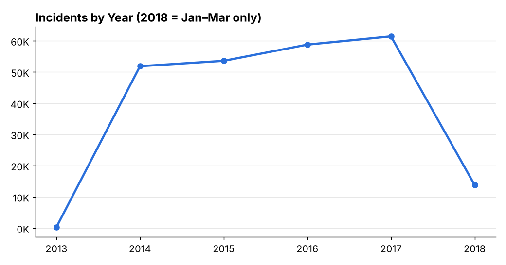
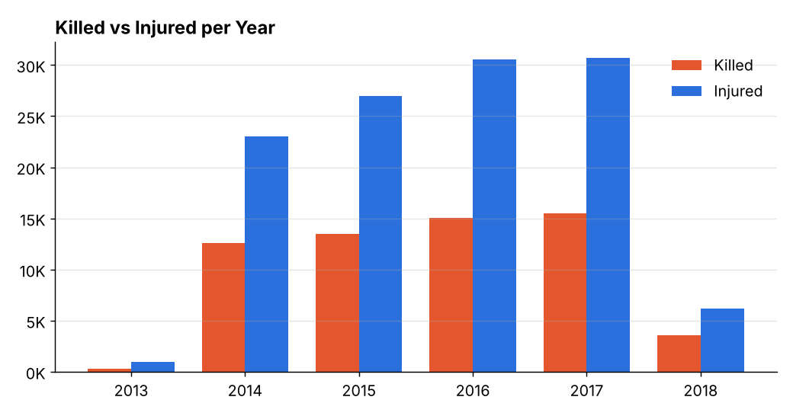
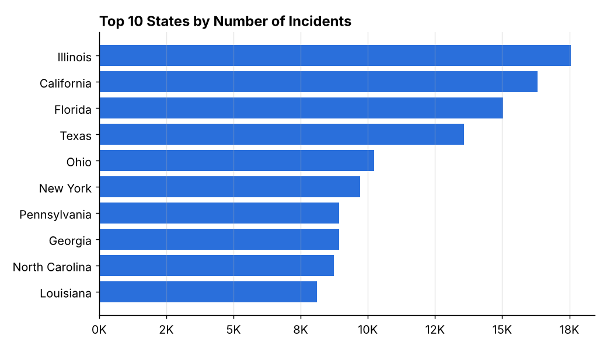

# U.S. Gun Violence — Interactive Power BI Dashboard

**Type:** Individual project · **Date:** November 2025 · **Tools:** Power BI Desktop, DAX, Power Query

## The problem
A raw dataset of every recorded U.S. gun-violence incident from January 2013 to March 2018 — **239,677 rows, 29 columns, ~150 MB** — is impossible to understand in a spreadsheet. The goal was to turn it into a dashboard that answers, in seconds: *How big is the problem? Is it growing? Where is it concentrated?*

## What I did
1. **Loaded and prepared the data** in Power Query — checked data types and prepared a Year field from the incident date for trend analysis.
2. **Wrote DAX measures** for the four headline KPIs: `Total Incidents`, `Total Killed`, `Total Injured`, and `Total Casualties` (killed + injured).
3. **Designed a two-page report:**
   - **Overview page** — 4 KPI cards, a line chart of *Incidents by Year*, a clustered column chart of *Killed vs Injured per Year*, and **Year** and **State** slicers so any user can filter the whole page.
   - **States Analysis page** — a filled map showing how incidents are distributed across all 51 states (incl. D.C.).

## Key findings
| KPI | Value |
|---|---|
| Total incidents | **239,677** |
| Total killed | **60,468** |
| Total injured | **118,402** |
| Total casualties | **178,870** |

- Incidents rose **every full year**, from 51,854 (2014) to 61,401 (2017) — an increase of about **18%**.
- Roughly **2 people are injured for every person killed**, and this ratio holds steady over time.
- **Illinois, California, Florida and Texas** record the most incidents.
- Data caveat I flagged: 2013 is very incomplete (278 records) and 2018 covers only January–March, so trends should be read from 2014–2017.

## Visuals
> Charts below are re-drawn from the same dataset to preview the dashboard's main views.

## Files
- **Dashboard (.pbix):** available under this repository's **Releases** (file is larger than GitHub's browser-upload limit).
- **Dataset:** [Gun Violence Data on Kaggle](https://www.kaggle.com/datasets/jameslko/gun-violence-data) (source: Gun Violence Archive).

## Skills demonstrated
Large-dataset handling · Power Query · DAX measures · KPI design · interactive filtering · geographic visualization · data-quality judgment
