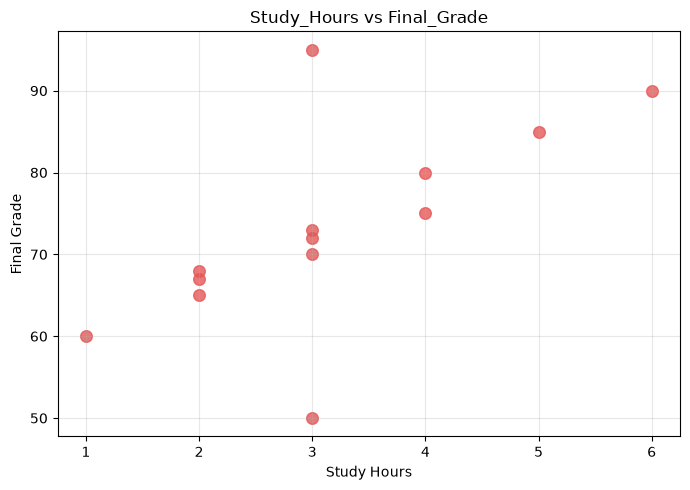
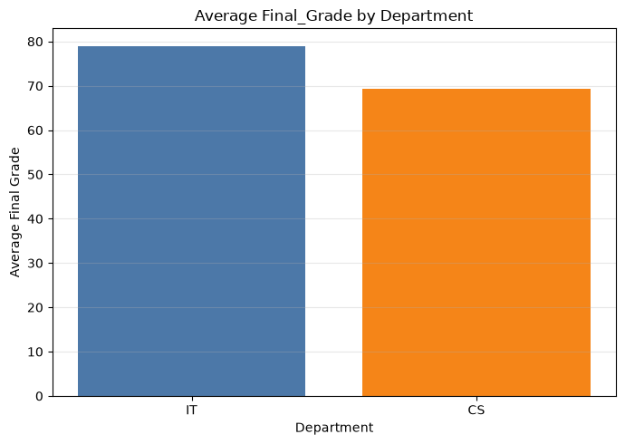
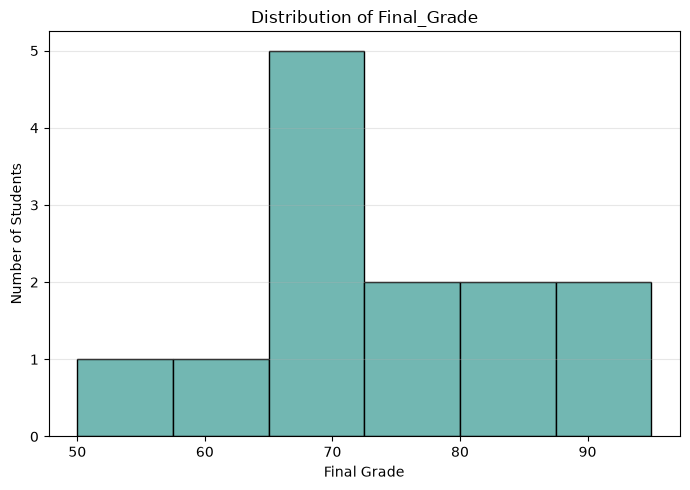
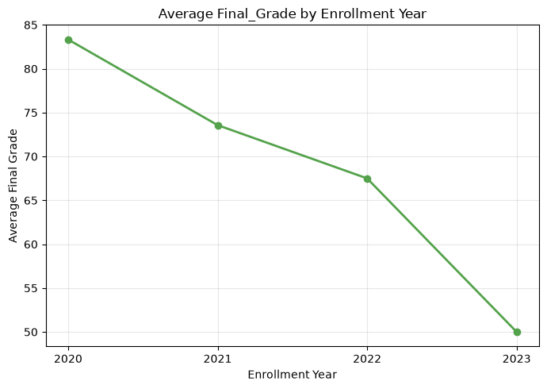

# Student Performance — Data Cleaning & Exploratory Data Analysis (Python)

**Type:** Individual assignment · **Course:** MIS 419 – Knowledge Management & Data Mining · **Date:** September 2026
**Tools:** Python, pandas, NumPy, Matplotlib, Jupyter Notebook

## The problem
A student records dataset (ID, age, study hours, final grade, department, enrollment year, attendance) contained quality issues. The task: clean it properly, then answer business questions about what drives student performance.

## What I did
1. **Data quality inspection** — profiled every column with `info()`, `describe()` and `isnull()`. Found:
   - a **missing `Age`** value,
   - an **impossible `Study_Hours` value of −1**,
   - an **inconsistent department code** (`SE`) outside the expected categories.
2. **Cleaning** — chose fixes that don't distort the data:
   - filled missing age with the **median** (robust to outliers),
   - replaced the negative study hours with the **median of valid (positive) values**,
   - standardized department codes, then **verified** that zero issues remained.
   - No valid record was deleted.
3. **Analysis** — calculated overall and per-department averages, the correlation between study hours and grades, and the number of at-risk students (attendance < 75%).
4. **Visualization** — 4 charts, each chosen for the question it answers (bar, histogram, scatter, line).

## Key findings
- **Study hours vs. final grade: r = 0.65** — a moderate positive relationship; more study generally means higher grades, but it doesn't explain everything.
- **IT students averaged 79.0 vs. 69.4 for CS.**
- **1 student** has attendance below 75% and is flagged as at risk.
- I noted a limitation: with only 13 records, the results should not be generalized.

## Visuals
| | |
|---|---|
|  |  |
|  |  |

## Files
- [`student_performance_eda.ipynb`](student_performance_eda.ipynb) — full notebook with code and outputs

## Skills demonstrated
Data profiling · handling missing & invalid values · median imputation · correlation analysis · choosing the right chart · stating limitations honestly
