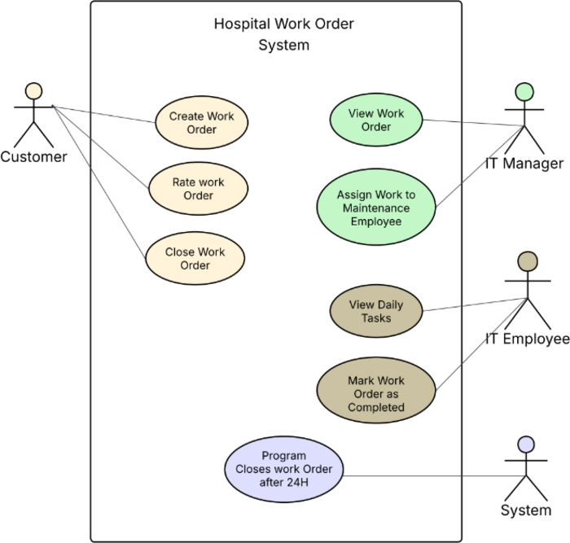
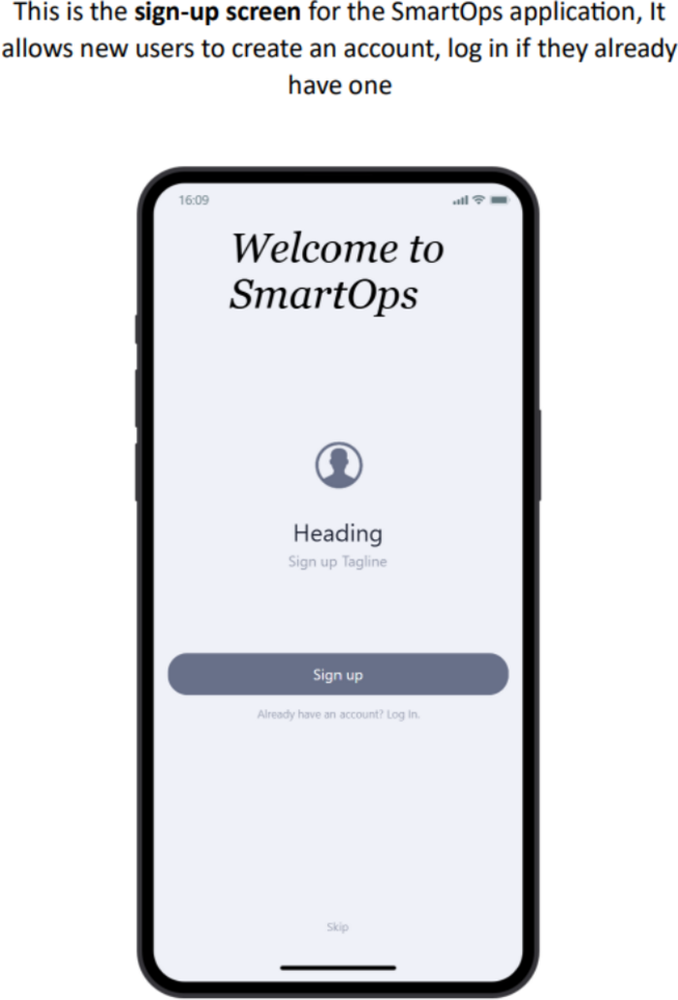
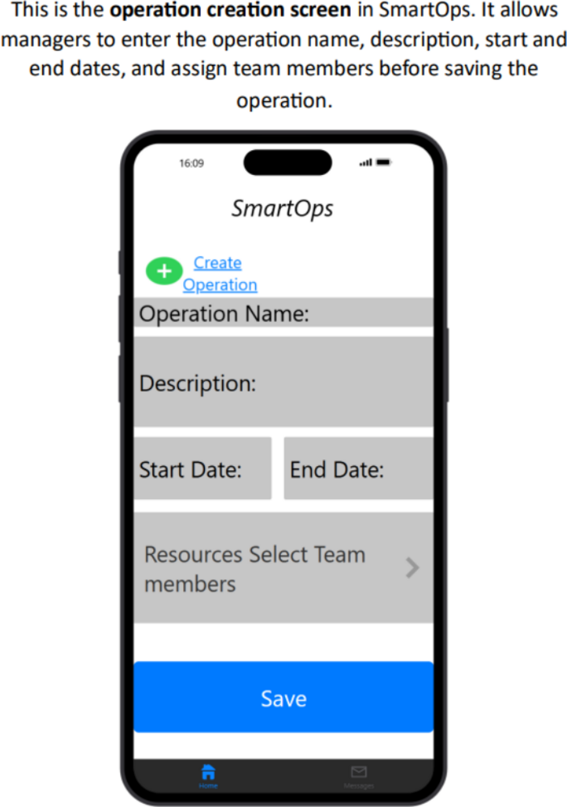
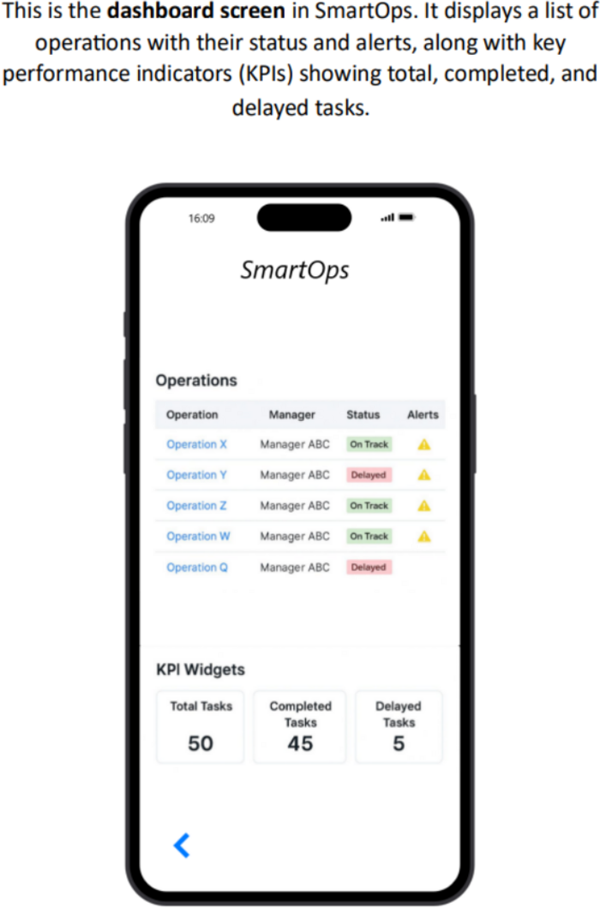
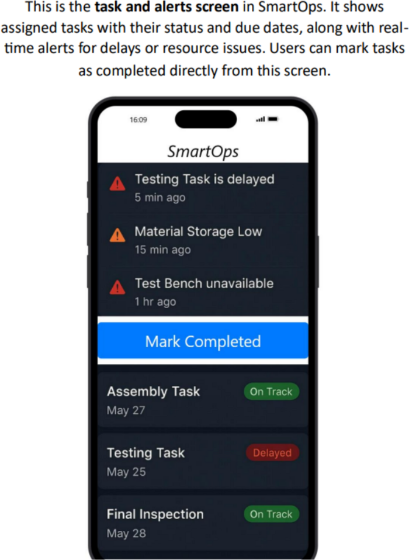
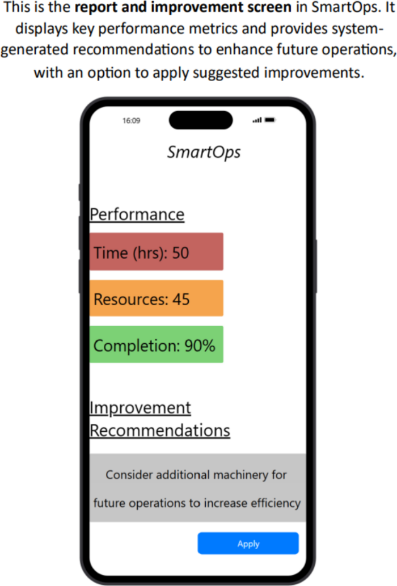

# SmartOps — System Analysis for a Hospital IT Work-Order Process

**Type:** Team project (7 members) · **Course:** MIS 215 · **Date:** November 2025
**Tools:** UML (use case diagram), mobile UI prototyping, Trello (project management)

## The problem
Kingdom Hospital handled IT service requests **manually**: doctors told a manager, who assigned the issue to IT staff, with tracking done in **Excel files and printed forms**. Requests were slow, information got lost, and follow-up was difficult.

## What we did
1. **Analysed the current (as-is) process** and identified the pain points: delays, lost information, no tracking.
2. **Defined the new system — SmartOps**, with clear objectives: reduce delays, improve task tracking and allocation, give management accurate performance reports, and automate alerts.
3. **Identified the users and their roles** — Operations Manager, Employee / Team Member, Technical Supervisor.
4. **Designed the to-be workflow** in 9 steps: secure login → create operations & tasks → automated resource allocation → task execution → smart alerts → real-time KPI dashboard → issue escalation → automated reports → improvement recommendations.
5. **Modelled the requirements** with a UML **use case diagram** (actors: Customer, IT Manager, IT Employee, System).
6. **Prototyped 5 mobile screens** to visualise the proposed system.
7. **Managed the team's work on Trello**.

## Use case diagram

## Prototype screens
| Sign-up | Create operation | KPI dashboard | Tasks & alerts | Reports |
|---|---|---|---|---|
|  |  |  |  |  |

## Files
- [`smartops_milestone2_system_analysis.docx`](smartops_milestone2_system_analysis.docx) — full Milestone 2 deliverable

## Skills demonstrated
Business process analysis · requirements gathering · stakeholder & role definition · UML · KPI dashboard design · prototyping · teamwork · Trello
